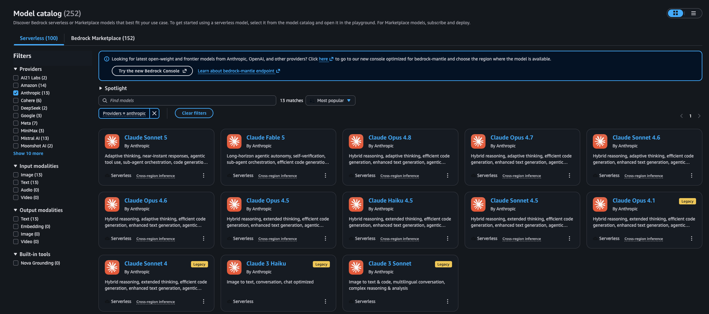

# MongoDB + AWS Bedrock Multi-Agent Framework

### Table of Contents

1. [Overview](#overview)
2. [Key Objectives](#key-objectives)
3. [Use Case: Career & Recruitment Assistant](#use-case-career--recruitment-assistant)
4. [Agents Involved](#agents-involved)
5. [Runtime Chatbot](#runtime-chatbot)
6. [Architecture Design](#architecture-design)
7. [Demo Scope](#demo-scope)
8. [Getting started](#getting-started)
9. [Cost](#cost)
10. [Model access](#model-access)
11. [Pre-Requisites](#pre-requisites)
12. [Setup](#setup)
    * [Clone repo & install dependencies](#clone-repo--install-dependencies)
    * [Configure agents and skills](#configure-agents-and-skills)
    * [Deployment](#deployment)
    * [Run webapp locally](#run-webapp-locally)
13. [Project Structure](#project-structure)
14. [Cleanup](#cleanup)
15. [Built With](#built-with)

## Overview

This project provides guidance and a reference architecture on how to deploy agents at scale using AWS Bedrock AgentCore and MongoDB Atlas. It features a configuration-driven multi-agent framework utilizing the Strands Agents TypeScript SDK and JWT-secured HTTP APIs. 

The framework is designed so developers can easily add specialists by editing markdown configurations (`.agent.md`) without requiring underlying application code changes. 

### Key Objectives

* Provide a scalable, configuration-driven multi-agent architecture on AWS Bedrock.
* Abstract complex agent configurations using markdown (`.agent.md` and `SKILL.md`).
* Provide seamless database integration with MongoDB Atlas for both operational data and memory (short-term and long-term vector/BM25 hybrid search).
* Offer flexible and secure networking deployments out of the box (AWS PrivateLink, VPC Peering, or Public paths).
* Ensure enterprise-grade observability and JWT-secured access controls.

## Use Case: Career & Recruitment Assistant

To demonstrate the capabilities of our multi-agent system on AWS Bedrock and MongoDB Atlas, we've built a career and recruitment assistant. This use case showcases how specialized agents can collaborate to match candidates to open roles via hybrid search, plan a candidate's skill development and compensation expectations, and research hiring companies through retrieval-augmented generation (RAG).

### Agents Involved

1. **Orchestrator Agent**: Handles the fallback routing path and directs candidate messages to the proper specialists.
2. **Job Match Agent**: Matches candidate CVs to open job listings using hybrid search, and supplies interview preparation material.
3. **Career Coach Agent**: Produces skill-gap reports and phased learning roadmaps, and provides grounded compensation benchmarks and negotiation framing.
4. **Company Intel Agent**: Researches hiring companies — culture, engineering practices, funding stage, and employee sentiment — over the `companies` collection and Bedrock Knowledge Bases.
5. **MongoDB MCP Runtime**: A dedicated Model Context Protocol (MCP) runtime hosting tools like `mongodb_query`, `mongodb_vector_search`, and `mongodb_aggregate` utilized by the specialists.

## Runtime Chatbot

The frontend is a React-like **Streamlit** UI that provides chat interfaces, session management, and a trace viewer for runtime inspection. 

The backend relies on a **Bun + Hono API** architecture. The API receives inquiries, leverages an in-API classifier to instantly pick the right specialist, and triggers the specialist as an AgentCore Runtime on AWS Bedrock. The API streams the agent's reasoning and responses back to the UI over Server-Sent Events (SSE).

## Architecture Design


1. The user types a question into the **Streamlit UI**, secured by **Amazon Cognito**.
2. The **Hono API** receives the request, and an in-API classifier dynamically selects the best specialist agent for the task (Single-hop default path). 
   * *Note: Enabling `USE_ORCHESTRATOR_RUNTIME=1` creates a two-hop rollback path routing through the Orchestrator.*
3. The selected specialist agent runs as an **AgentCore Runtime** on AWS Bedrock, reasoning through the prompt and streaming the answer back via SSE.
4. If a specialist needs to query a database, perform hybrid search, or aggregate metrics, it triggers tools that route through the dedicated **MongoDB MCP AgentCore Runtime**.
5. **MongoDB Atlas** serves as the system's operational database, vector store, and long-term memory backend.
6. System logs and traces are emitted through **OpenTelemetry (ADOT)** to **Amazon CloudWatch**.

## Demo Scope

1. **Skill-Gap Analysis and Learning Roadmaps**: The Career Coach Agent hybrid-searches `career_paths` and `skills_taxonomy` to diff a candidate's skills against a target role and return a phased plan.
2. **Compensation Intelligence**: The same Career Coach Agent pre-filters `compensation_data` by seniority and region to return percentile pay bands with currency, sample size, and freshness.
3. **Company Research**: The Company Intel Agent combines hybrid search over the `companies` collection with Bedrock Knowledge Bases to answer "what is it actually like to work there".
4. **CV-to-Job Matching**: The Job Match Agent ranks open listings against a submitted CV and supplies interview prep. *(Requires `jobs` / `candidates` / `interview_prep` fixtures — see the seed-data note in [`docs/reference/data-model.md`](docs/reference/data-model.md).)*
5. **Configuration-Driven Runtimes**: Expanding the demo is as simple as adding a new `<name>.agent.md` file in `config/agents/` along with a `SKILL.md` domain package. 

## Getting started

### Cost
You are responsible for the cost of the AWS services and MongoDB Atlas infrastructure used while running this guidance. Primary cost drivers include AWS Bedrock model inference, EC2 instances hosting the API/UI, and the MongoDB Atlas cluster tier.

### Model access
Navigate to the Amazon Bedrock console, and ensure you have enabled access to the following models:
* `Claude Haiku 4.5` (Orchestrator, Job Match, and Career Coach default)
* `Claude Sonnet 4.6` (Company Intel default)
* `Titan Embeddings` (Or your preferred embeddings provider like Voyage)



## Pre-Requisites

Before you begin, ensure you have the following installed and configured:
* **Bun** (latest) - Required for API workflows.
* **Python** (3.10+) - Used for smoke and support scripts.
* **AWS CLI** (v2) - Configured with your AWS credentials.
* **Terraform** (1.6+) - Required for infrastructure deployment.
* **Docker** (latest) - Required for EC2 deployments.
* **MongoDB Atlas Account** - You will need an Atlas API key and an existing project.

## Setup

### Clone repo & install dependencies

Clone the repository and set up your local environment file:

```bash
git clone https://github.com/mongodb-partners/Multi-Agent-Architectural-Guidance-Bedrock-AgentCore.git
cd Multi-Agent-Architectural-Guidance-Bedrock-AgentCore
cp .env.sample .env
```
Edit the `.env` file with your AWS credentials, Atlas keys, `PROJECT_NAME`, `ENVIRONMENT`, `AWS_REGION`, and preferred embeddings provider.

### Configure agents and skills

Most customization happens via markdown and requires no API or runtime code changes:
* **Agents** live in `config/agents/<name>.agent.md`. You can define custom instructions, required skills, and memory preferences here.
* **Skills** live in `config/skills/<skill-name>/SKILL.md`. They can include optional HTTPS tools (`http-tools.json`), reference documents, and execution scripts.

### Deployment

Deploy scripts run centralized preflight checks before applying infrastructure. You must source the `.env` file before executing them.

**1. AWS PrivateLink (Recommended)**
```bash
source .env
./deploy/deploy-full-with-privatelink.sh --auto-approve
```

**2. VPC Peering**
```bash
source .env
./deploy/deploy-full-with-vpc-peering.sh --auto-approve
```

**3. Public Path (Demo Only - Bring Your Own Cluster)**
```bash
source .env
./deploy/deploy-full-public.sh --auto-approve
```

After a successful deployment, the `.env.live` file will be generated with your `AUTH_JWKS_URI`, `AUTH_ISSUER`, and `AgentCore ARNs`. A post-deployment smoke test will automatically run.

### Run webapp locally

Once you have completed a full EC2 deploy (which merges `.env.live`), you can run the application locally. 

**Terminal 1 (Hono API):**
```bash
source .env
source .env.live
export PATH="$HOME/.bun/bin:$PATH"

cd api
bun run typecheck && bun run validate:bun && bun run validate:agentcore && bun run dev
```

**Terminal 2 (Streamlit UI):**
```bash
cd ui
streamlit run app.py
```
Visit `http://localhost:8501`. Note: Cognito JWT is required to sign in; there is no anonymous mode.

## Project Structure

```text
api/              Bun + Hono API (SSE, JWT, AgentCore adapters)
ui/               Streamlit (Chat, Sessions, Trace Viewer)
mcp-runtimes/     MongoDB MCP AgentCore Runtime
config/
  agents/         .agent.md specialists
  samples/        Reference-only config examples
  skills/         SKILL.md domain packages
deploy/           Terraform + deploy scripts
db-seeding/       Atlas demo data + indexes
e2e/              Playwright (live API)
e2e-smoke/        Post-deploy AWS smoke
docs/             Getting started, architecture, and runbooks
```

## Cleanup

To avoid incurring future charges, destroy the deployed infrastructure. Match the destroy script with your deployed network mode:

```bash
# Example for PrivateLink teardown
./deploy/destroy/destroy-project-with-privatelink.sh --auto-approve
./deploy/destroy/destroy-shared-with-privatelink.sh --auto-approve
```

## Built With

* **Strands Agents SDK** - Agent orchestration
* **Hono** - HTTP API + Server-Sent Events (SSE)
* **MongoDB Atlas** - Operational data, vector search, and long-term memory
* **AWS Bedrock** - Claude models, Titan embeddings, and Knowledge Bases
* **Bedrock AgentCore** - Runtimes, Gateway, and Memory
* **Agent Skills** - Modular skill formatting
* **Streamlit** - Chat interface and Trace Viewer
* **OpenTelemetry + ADOT** - Infrastructure tracing and logging
