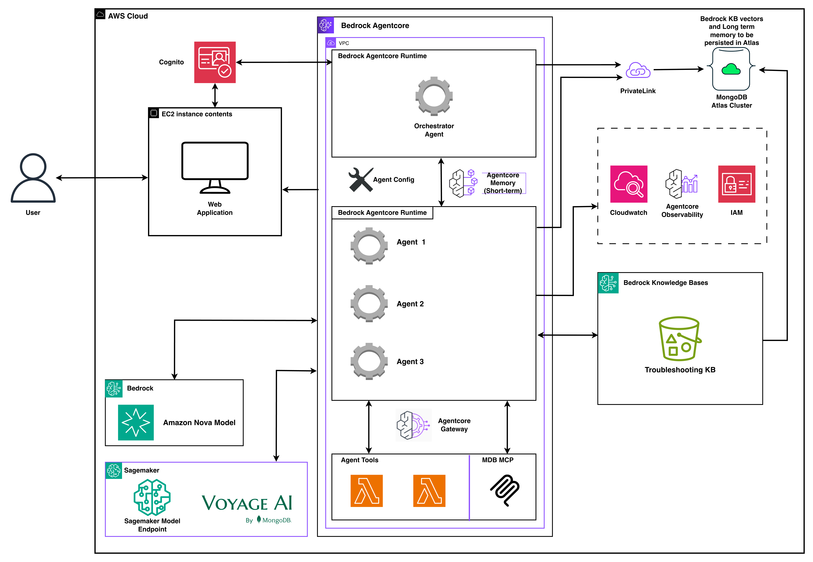

# Guidance for Multi-Agent Orchestration on AWS with MongoDB Atlas

## Table of Contents

- [Overview](#overview)
  - [Key Objectives](#key-objectives)
  - [Use Case: Intelligent Retail Support](#use-case-intelligent-retail-support)
  - [Agents Involved](#agents-involved)
  - [Runtime Chatbot](#runtime-chatbot)
  - [Architecture Design](#architecture-design)
  - [Demo Scope](#demo-scope)
- [Cost](#cost)
- [Prerequisites](#prerequisites)
  - [Model Access](#model-access)
- [Getting Started](#getting-started)
- [Deployment](#deployment)
- [Running the Guidance](#running-the-guidance)
- [Cleanup](#cleanup)
- [Security](#security)
- [Authors and Acknowledgment](#authors-and-acknowledgment)
- [License](#license)

---

## Overview

This Guidance demonstrates a **configuration-driven multi-agent reference architecture** built on **AWS Bedrock AgentCore**, the **Strands Agents TypeScript SDK**, and **MongoDB Atlas**. A user asks a question in a Streamlit chat UI; a JWT-secured Hono API classifies the request and routes it to the right specialist agent, which runs as an isolated **AgentCore Runtime** and streams its answer back over Server-Sent Events (SSE).

The defining trait of this Guidance is that **domain behavior lives in markdown, not code**. Specialists are defined in `*.agent.md` files and their knowledge in `SKILL.md` packages. Adding a new vertical means adding a new agent + skill and redeploying — no framework code changes.



### Key Objectives

- **Configuration over code** — add or change specialist agents by editing markdown, keeping the framework layer stable.
- **Isolated, scalable agents** — each specialist runs as its own Bedrock AgentCore Runtime, independently deployable and scalable.
- **Grounded, stateful answers** — MongoDB Atlas provides operational data, vector search, and hybrid (vector + BM25) long-term memory keyed to each user.
- **Secure by default** — mandatory JWT (Cognito) auth, private MongoDB connectivity (PrivateLink or VPC peering), and SSRF allowlists on HTTP tools.

### Use Case: Intelligent Retail Support

The reference implementation is a retail customer-support assistant. A shopper can ask about an existing order, request a product recommendation, or troubleshoot a product — and the system routes each request to a specialist that has the right data and tools, then remembers relevant facts across sessions.

### Agents Involved

| Agent | Default model | Responsibility |
|---|---|---|
| Orchestrator | Claude Haiku 4.5 | (Rollback path) routes requests to specialists |
| Order Management | Claude Haiku 4.5 | Order lookups, status, tracking, returns |
| Product Recommendation | Claude Sonnet 4.6 | Semantic search over the `products` catalog |
| Troubleshooting | Claude Sonnet 4.6 | RAG over `troubleshooting_docs` + a Bedrock Knowledge Base |

A fifth runtime hosts the **MongoDB MCP** server (`mongodb_query`, `mongodb_vector_search`, `mongodb_aggregate`), which every agent calls through the AgentCore Gateway.

### Runtime Chatbot

The front end is a **Streamlit** application (Chat, Sessions, and a debug-grade Trace Viewer). It authenticates against Amazon Cognito, calls the Hono API over HTTPS, and renders the streamed SSE response token-by-token, including per-turn cards for activated skills, vector-search previews, and long-term-memory writes.

### Architecture Design

1. **User → UI.** The shopper signs in via Cognito and submits a question in the Streamlit chat.
2. **UI → API.** The Streamlit client sends the turn (with its JWT) to the Hono API over HTTPS/SSE.
3. **Classification.** An in-API classifier inspects the message and selects the best specialist agent (default **single-hop** path). Setting `USE_ORCHESTRATOR_RUNTIME=1` enables a two-hop path through the Orchestrator runtime instead.
4. **API → Specialist Runtime.** The API invokes the chosen specialist's **AgentCore Runtime**, passing the message plus short- and long-term memory context.
5. **Tools → Data.** The specialist calls MongoDB tools through the **MongoDB MCP AgentCore Runtime** (via AgentCore Gateway) and, where relevant, retrieves from a Bedrock Knowledge Base — reaching MongoDB Atlas over **PrivateLink** or **VPC peering**.
6. **Response + Memory.** The runtime streams the answer back through the API to the UI over SSE, while the API persists the session and writes durable facts to Atlas long-term memory.

### Demo Scope

- Configuration-driven specialists and skills (markdown authoring, no code changes)
- In-API single-hop classification (optional two-hop orchestrator)
- MongoDB vector search and hybrid (vector + BM25, RRF + recency + MMR) long-term memory
- Bedrock Knowledge Base RAG for troubleshooting
- Multimodal embeddings (text + image) via Titan or Voyage
- End-to-end tracing (OpenTelemetry + AWS X-Ray) surfaced in the Trace Viewer
- Cognito-secured chat with per-user session history

---

## Cost

You are responsible for the cost of the AWS services used while running this Guidance. Primary cost drivers are **Bedrock model invocations** (Claude + embeddings), **EC2** (API + UI hosts), **AgentCore Runtimes** (5 of them), a **SageMaker endpoint** (only if using Voyage embeddings), **CloudWatch/X-Ray**, and **MongoDB Atlas** (billed separately by MongoDB).

For a full, itemized monthly estimate, see [`docs/estimate.md`](docs/estimate.md). Costs vary with request volume, model choice, and whether you use Titan (Bedrock built-in, no SageMaker) or Voyage embeddings.

> We recommend creating an [AWS Cost Budget](https://docs.aws.amazon.com/cost-management/latest/userguide/budgets-managing-costs.html) and running the [Cleanup](#cleanup) steps when you are done.

---

## Prerequisites

| Tool | Version | Install |
|---|---|---|
| [Bun](https://bun.sh) | latest | `curl -fsSL https://bun.sh/install \| bash` then `export PATH="$HOME/.bun/bin:$PATH"` |
| Python | 3.10+ | `python3 --version` |
| AWS CLI | v2 | [Install guide](https://docs.aws.amazon.com/cli/latest/userguide/getting-started-install.html) |
| Terraform | ≥ 1.6 | [Install guide](https://developer.hashicorp.com/terraform/install) |
| Docker | latest | Required for EC2 deploys |
| AWS Session Manager plugin | latest | `brew install --cask session-manager-plugin` (macOS) |

You also need an **AWS account** with the permissions in [`deploy/iam/policy.json`](deploy/iam/policy.json) (see [`deploy/iam/README.md`](deploy/iam/README.md)) and a **MongoDB Atlas** account with an API key and an existing project.

### Model Access

Enable the following models in the Amazon Bedrock console (**Model access**) in your deployment region before deploying:

- **Anthropic Claude Haiku 4.5**
- **Anthropic Claude Sonnet 4.6**
- **Amazon Titan Text Embeddings** (if `EMBEDDINGS_PROVIDER=titan` — recommended for a first deploy)

If you choose Voyage embeddings (`EMBEDDINGS_PROVIDER=voyage`, the `.env.sample` default), the deploy provisions a SageMaker endpoint and may require a Marketplace subscription.

---

## Getting Started

```bash
git clone <repo-url>
cd multiagent-mongo-repo

cp .env.sample .env
# Edit .env — AWS creds, Atlas keys, PROJECT_NAME, ENVIRONMENT, AWS_REGION, SHARED_VPC_NAME
# Simplest first deploy: EMBEDDINGS_PROVIDER=titan

source .env
aws sts get-caller-identity   # confirm your AWS identity
```

The full environment-variable catalog is in [`.env.sample`](.env.sample) and [`docs/reference/env-vars.md`](docs/reference/env-vars.md). Role-based onboarding lives in [`docs/README.md`](docs/README.md).

---

## Deployment

Always `source .env` before running any deploy script. Connectivity mode is **mutually exclusive per account** and switching requires a destroy + redeploy.

| Goal | Command |
|---|---|
| **PrivateLink** (recommended) | `./deploy/deploy-full-with-privatelink.sh --auto-approve` |
| **VPC peering** | `./deploy/deploy-full-with-vpc-peering.sh --auto-approve` |
| **Public — bring your own Atlas cluster** (demo only) | `./deploy/deploy-full-public.sh --auto-approve` |

```bash
source .env
./deploy/deploy-full-with-privatelink.sh --auto-approve
```

Common flags: `--skip-docker`, `--skip-network`, `--skip-shared`, `--skip-smoke`, `--env-file PATH`.

**Targeted redeploys** (after a successful full deploy):

```bash
./deploy/deploy-agents.sh --auto-approve   # only config/agents/*.agent.md or config/skills/ changed
./deploy/deploy-api.sh                      # only api/ changed
./deploy/deploy-ui.sh                       # only ui/ changed
```

Full runbook: [`docs/deployment-guide.md`](docs/deployment-guide.md). Script reference: [`docs/reference/deploy-scripts.md`](docs/reference/deploy-scripts.md).

---

## Running the Guidance

A post-deploy smoke test runs automatically at the end of the full deploy. To re-run it:

```bash
source .env && python3 e2e-smoke/post-deploy-smoke.py
```

Open the **UI URL** printed in the deploy summary (Streamlit on EC2, port 8501) and sign in with the Cognito test user from the deploy output. Try the sidebar demo prompts to route to each specialist. Walkthrough: [`docs/demo/demo-script.md`](docs/demo/demo-script.md).

---

## Cleanup

Tear down **project first, then shared/network**, matching the `NETWORK_MODE` you deployed:

```bash
# PrivateLink
./deploy/destroy/destroy-project-with-privatelink.sh --auto-approve
./deploy/destroy/destroy-shared-with-privatelink.sh --auto-approve

# VPC peering variants
./deploy/destroy/destroy-project-with-vpc-peering.sh --auto-approve
./deploy/destroy/destroy-shared-with-vpc-peering.sh --auto-approve
```

Teardown entrypoint and caveats: [`deploy/destroy/README.md`](deploy/destroy/README.md).

---

## Security

- **Authentication is mandatory** — the API will not start without `AUTH_JWKS_URI` + `AUTH_ISSUER`. Every request carries a Cognito JWT; its `sub` scopes sessions and long-term memory. There is no anonymous mode.
- **Private data connectivity** — MongoDB Atlas is reached over PrivateLink or VPC peering by default; the public path is demo-only and gated behind explicit opt-in.
- **SSRF protection** — HTTP tools are constrained by allowlists in `config/http-tools.json` and per-skill `http-tools.json`.
- **Observability** — structured JSON logs, OpenTelemetry traces, and X-Ray for auditing agent behavior.

See [`docs/status/debugging.md`](docs/status/debugging.md) and [`AGENTS.md`](AGENTS.md) for operational conventions.

---

## Authors and Acknowledgment

- Anuj Panchal
- MongoDB Partners team

Built with the [Strands Agents SDK](https://github.com/strands-agents/sdk-typescript), [Hono](https://hono.dev/), [MongoDB Atlas](https://www.mongodb.com/atlas), [AWS Bedrock](https://aws.amazon.com/bedrock/) + [AgentCore](https://docs.aws.amazon.com/bedrock-agentcore/), [Agent Skills](https://agentskills.io/specification), [Streamlit](https://streamlit.io/), and [OpenTelemetry](https://opentelemetry.io/).

---

## License

This Guidance is licensed under the [Apache License 2.0](LICENSE).
